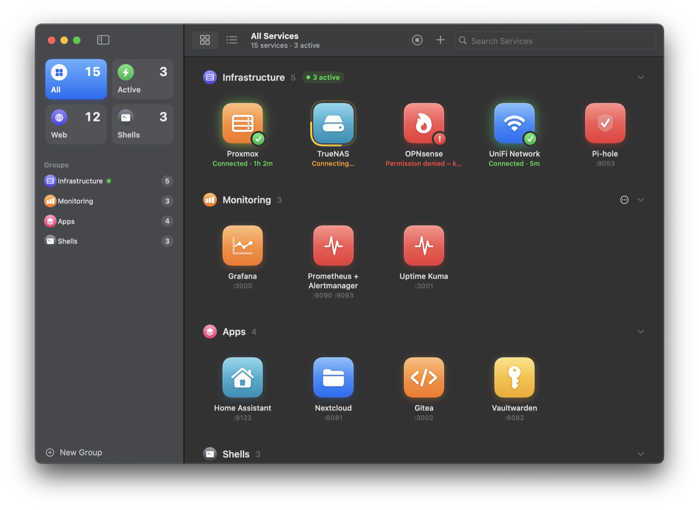
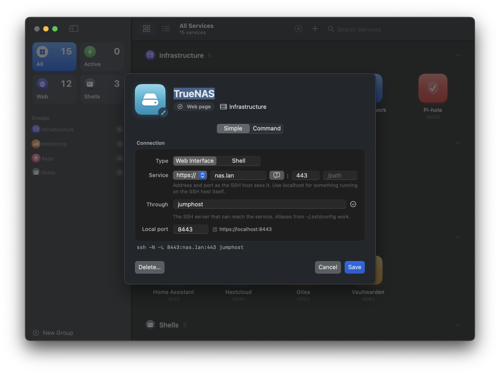
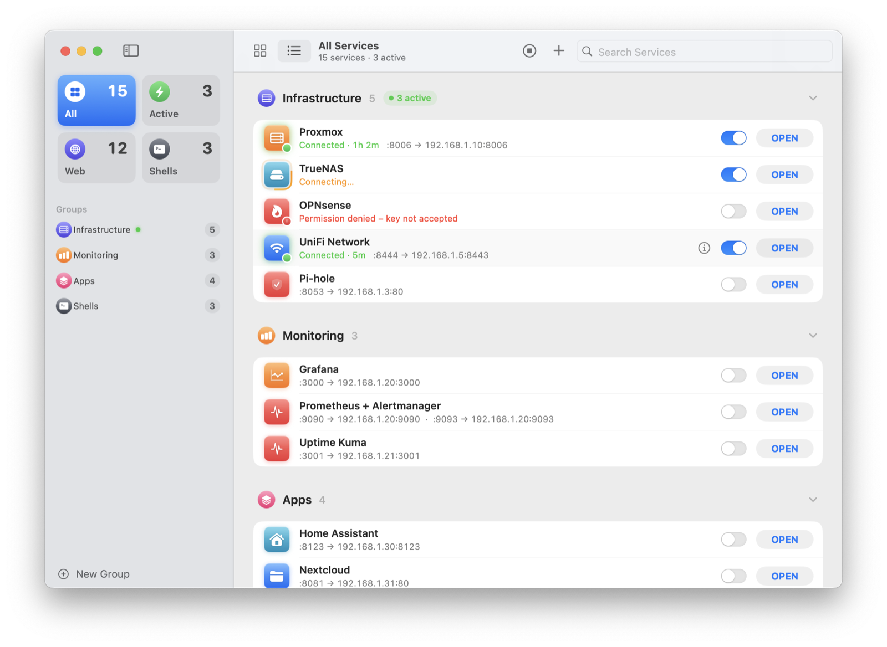

<p align="center">
  
</p>

<h1 align="center">InfraLauncher</h1>

<p align="center">
  A small macOS app for the web UIs and shells that live behind your jump host.<br>
  One click opens the SSH tunnel and then the page.
</p>

<p align="center">
  
  
  
  
</p>

<p align="center">
  
</p>

---

## Why

If your Proxmox, firewall, NAS or Grafana only answer inside a private network, you probably know this routine:

```sh
ssh -N -L 8006:192.168.1.10:8006 me@jumphost
# new terminal tab, open browser, type localhost:8006, forget which port was which...
```

InfraLauncher keeps those commands in one place, grouped the way you think about them. Click a service and it starts the tunnel if needed, waits until the ports are really listening, and then opens the URL in your browser. Shell entries open a window in Terminal, iTerm2 or another terminal app instead.

It's a handful of Swift files, it builds with the Command Line Tools, and it doesn't phone home or need an account. Your list stays on your Mac.

## What it does

- **Tunnel and open in one go.** Click a service and the page opens as soon as the forward is up, not before.
- **Icons or a list.** Switch between an app-icon grid and a compact list with <kbd>⌘</kbd> <kbd>1</kbd> / <kbd>⌘</kbd> <kbd>2</kbd>. Every service gets an icon and color picked from its name (Proxmox, Grafana, Pi-hole, NAS, …), and you can choose your own.
- **Groups.** Sort services into groups like *Infrastructure* or *Customer A*. Collapse them, start or stop every tunnel in a group at once, and see at a glance where something is running.
- **Drag to rearrange.** Drag services to reorder them, into another group, or onto a group in the sidebar.
- **Find things fast.** Search by name, command or URL. Collections for *Active*, *Web* and *Shells* sit at the top of the sidebar.
- **A builder for the command.** In Simple mode you fill in the address, port and SSH host and the `ssh -L` command and URL are written for you, with a free local port picked automatically. Switch to Command mode any time to write it yourself.
- **Menu bar.** Start tunnels and open services from the menu bar without bringing up the window.
- **Knows when a tunnel is actually ready.** It runs `ssh -v` and watches for every `-L` port to report "listening". The dot turns green only then.
- **Clear errors.** Wrong key, host down, DNS failure, port already taken: the row tells you in plain words instead of a dead browser tab.
- **Several forwards per entry.** Put Prometheus and Alertmanager into one entry with two `-L` and two URLs, and both tabs open.
- **Shells too.** Entries without a URL open in Terminal, iTerm2, Ghostty, kitty, WezTerm or Alacritty (pick one in Settings), for example `ssh -J jumphost admin@192.168.1.40`.
- **Ask for a value.** Write `<ip>` (or `<host>`, or any `<name>`) in a command and you're asked for it when you open the service. The last few values are remembered. Handy for "shell on whatever box I need right now".
- **Uptime.** Running tunnels show how long they've been connected.
- **Checks ports before it starts.** If something else already sits on the local port, you get told up front.
- **Stays alive.** Keepalives are set, so a dead connection shows up as an error instead of hanging forever.
- **Cleans up after itself.** Quit the app or close the window and every tunnel it started goes with it. No orphaned `ssh` processes holding your ports.

## Requirements

- macOS 14 Sonoma or newer
- Apple Silicon or Intel
- Xcode Command Line Tools: `xcode-select --install`
- SSH **key** login to your jump host. Tunnels run in the background with `BatchMode=yes`, so there's nowhere to type a password.

## Download

Grab `InfraLauncher.zip` from the [latest release](https://github.com/corrooli/InfraLauncher/releases/latest), unzip it and move `InfraLauncher.app` to Applications. It runs on Apple Silicon and Intel.

The app is not notarized, so macOS blocks it on first launch. Either open **System Settings → Privacy & Security** and click **Open Anyway**, or remove the quarantine flag once:

```sh
xattr -dr com.apple.quarantine /Applications/InfraLauncher.app
```

If you'd rather not trust a downloaded binary, build it yourself; it takes about a minute.

## Build and install

```sh
git clone https://github.com/corrooli/InfraLauncher.git
cd InfraLauncher
./build.sh install
```

That compiles the app, draws the icon, signs it ad hoc and copies it to `/Applications`. Run `./build.sh` without `install` if you only want the bundle in `build/`.

Because you build it yourself, Gatekeeper won't complain on first launch.

## Getting started

### 1. Give your jump host a name

The example entries use a host called `jumphost`. The easiest way to make them work is an alias in `~/.ssh/config`:

```ssh-config
Host jumphost
    HostName jump.example.com
    User admin
    IdentityFile ~/.ssh/id_ed25519
```

Now `ssh jumphost` should log you in without asking anything. If your key has a passphrase, load it into the agent once and macOS will remember it:

```sh
ssh-add --apple-use-keychain ~/.ssh/id_ed25519
```

Anything you set up in `~/.ssh/config` (ports, users, `ProxyJump`, other aliases) also works inside InfraLauncher, because it just runs your `ssh`.

### 2. Make the list yours

On first launch you get a handful of examples. Right click a service and pick **Edit…** (or hover a row in list view and click ⓘ) to change it. The **+** in the toolbar, or <kbd>⌘</kbd> <kbd>N</kbd>, adds a new one. **New Group** at the bottom of the sidebar makes a group.

<p align="center">
  
</p>

The editor has two modes:

**Simple** is for the common cases. Pick *Web Interface* or *Shell* and fill in a few fields:

| Field      | What goes in                                                                                  |
|------------|-----------------------------------------------------------------------------------------------|
| Service    | `https://` or `http://`, the address and port as the SSH host sees them, and an optional path |
| Through    | The SSH host that can reach it, e.g. `jumphost` or `admin@jump.example.com`                   |
| Local port | Leave it empty and a free one is chosen (ports below 1024 become 8000 + port, so 443 → 8443)  |

For a shell you enter user, server and port, and optionally a jump host. Leave the jump host empty for a direct connection. The bubble button next to the address makes it ask for the host each time you open the service.

**Command** is the raw form, for everything else:

| Field   | What goes in                                                                     |
|---------|----------------------------------------------------------------------------------|
| Command | The full shell command, usually `ssh -N -L ...`                                  |
| Open    | One URL per line. Leave it empty and the entry opens in your terminal instead    |

The editor shows which local ports it found and warns you if another service already uses one of them. Click the icon at the top left to pick a different symbol or color.

## Command recipes

**A web UI on a machine the jump host can reach**

```sh
ssh -N -L 8006:192.168.1.10:8006 jumphost
```
Open: `https://localhost:8006`

**Hostnames work too.** They get resolved on the jump host, so internal DNS names are fine even if your Mac can't resolve them:

```sh
ssh -N -L 5001:nas.lan:5001 jumphost
```
Open: `https://localhost:5001`

**Two services, one entry**

```sh
ssh -N -L 9090:192.168.1.20:9090 -L 9093:192.168.1.20:9093 jumphost
```
Open:
```
http://localhost:9090
http://localhost:9093
```

**A service that only listens on 127.0.0.1 of some inner server.** Hop through the jump host with `-J` and forward from the inner box:

```sh
ssh -N -J jumphost -L 8081:127.0.0.1:81 admin@192.168.1.30
```
Open: `http://localhost:8081`

**A shell on a server behind the jump host** (leave Open empty)

```sh
ssh -J jumphost admin@192.168.1.40
```

**A shell on any host, asked each time**

```sh
ssh -J jumphost root@<ip>
```
The row gets an input field. Type the IP and press Enter.

**Not SSH at all.** The command runs through `/bin/sh`, so other long running forwarders work too:

```sh
kubectl port-forward svc/grafana 3000:80 -n monitoring
```
For these the app can't see the ports, so it counts the entry as up once the process has been running for a moment.

> [!TIP]
> Give every entry its own local port. Two entries on `:8006` can't run at the same time, and the app will tell you so.

## Using it

<p align="center">
  
</p>

| Action | How |
|---|---|
| Connect and open in the browser | Click the icon, or **OPEN** in list view |
| Start or stop only the tunnel | The switch in list view, or the power button when you hover an icon |
| Open a shell entry | Click it. It opens in the terminal app chosen in Settings |
| Edit, duplicate, move to a group, copy, delete | Right click a service |
| Reorder or regroup | Drag it |
| Start or stop a whole group | The ⋯ menu on the group header, or right click the group in the sidebar |
| Switch between icons and list | <kbd>⌘</kbd> <kbd>1</kbd> / <kbd>⌘</kbd> <kbd>2</kbd>, or the toolbar |
| Search | The search field in the toolbar |
| New service / new group | <kbd>⌘</kbd> <kbd>N</kbd> / <kbd>⇧</kbd> <kbd>⌘</kbd> <kbd>N</kbd> |
| Stop every tunnel | Toolbar button, or <kbd>⌘</kbd> <kbd>.</kbd> |
| Get the example list back | File menu, **Restore Example Services…** |

The icon tells you the state:

- no badge: off
- orange ring running around it: connecting
- green badge: all ports are listening
- red badge: failed, the reason is right below the name

### Menu bar and Settings

The menu bar icon lists all services with their state, a switch and an **OPEN** button. While it's on, closing the window keeps InfraLauncher and its tunnels running in the background. Quitting the app (<kbd>⌘</kbd> <kbd>Q</kbd> or **Quit** in the menu bar panel) still stops every tunnel. You can turn the icon off in **Settings** (<kbd>⌘</kbd> <kbd>,</kbd>); then closing the window quits the app like before.

Settings is also where you choose the terminal for shell entries. Only apps you have installed are listed. For iTerm2, macOS asks once whether InfraLauncher may control it; that's how it opens a new window with the command.

If you change the command of a running tunnel, it restarts with the new settings when you save.

If a tunnel is up but the target behind it doesn't answer, the row says *Target unreachable* in orange. The SSH part is fine in that case. Check the service itself.

## What happens under the hood

For commands that start with `ssh `, InfraLauncher adds a few options before running them:

| Option | Why |
|---|---|
| `-v` | So it can read "Local forwarding listening on ... port N" and know when each port is ready |
| `-o BatchMode=yes` | Never wait for a password prompt nobody can see |
| `-o StrictHostKeyChecking=accept-new` | New hosts are accepted the first time, changed keys are still refused |
| `-o ExitOnForwardFailure=yes` | Fail loudly if a port can't be bound, instead of running half broken |
| `-o ConnectTimeout=10` | Don't hang on hosts that aren't there |
| `-o ServerAliveInterval=15 -o ServerAliveCountMax=3` | Notice a dead connection within about 45 seconds |

If not all ports report in within 25 seconds, the tunnel is stopped and marked as timed out.

Your list is saved as plain JSON here:

```
~/Library/Application Support/InfraLauncher/services.json
~/Library/Application Support/InfraLauncher/groups.json
```

You can back them up, sync them, or edit them by hand while the app is closed. A service looks like this:

```json
{
  "id" : "6F1C2A4E-3B7D-4C1A-9E0F-2D8B5A7C1E33",
  "name" : "Proxmox",
  "command" : "ssh -N -L 8006:192.168.1.10:8006 jumphost",
  "urls" : [ "https://localhost:8006" ],
  "groupID" : "A1F0C2D4-0001-4000-8000-000000000001",
  "symbol" : "server.rack",
  "color" : "orange"
}
```

`groupID`, `symbol` and `color` are optional; without `symbol` and `color` the icon is picked from the name. Files from version 1 load as they are, with every service ungrouped. Any unique UUID works for `id`. Delete `services.json` and the app starts over with the examples.

## Troubleshooting

**"Permission denied" in red.** Your key wasn't accepted. Run the command in Terminal and see what SSH says. Often the key just isn't loaded in the agent (`ssh-add -l` to check).

**"Unknown host key".** The host key changed or can't be verified. Connect once in Terminal and sort it out there.

**"Port ... is already in use".** Something else holds that local port. Often it's a tunnel you started by hand earlier. Find it with:

```sh
lsof -nP -iTCP:8006 -sTCP:LISTEN
```

**"Timed out".** SSH connected but not every `-L` port came up. Check for typos in the forward, and that the jump host may forward at all (`AllowTcpForwarding` in its `sshd_config`).

**The browser warns about the certificate.** Expected. Things like Proxmox, DSM or OPNsense have certificates for their real name, not for `localhost`. Accept it once, or add the real name to `/etc/hosts` pointing at `127.0.0.1` and use that in the URL.

## Project layout

```
Sources/
  App.swift             app entry, menus, Settings, menu bar panel
  Model.swift           services, groups, colors, icon guessing
  Store.swift           saving, tunnel processes and their state
  MainWindow.swift      sidebar, icon grid, list
  Components.swift      icons, badges, buttons and pickers shared by the views
  Editors.swift         service and group editors
  CommandBuilder.swift  Simple mode: builds and reads ssh commands
  Terminals.swift       opening shells in Terminal, iTerm2, Ghostty, …
icon.swift              draws the app icon at build time
build.sh                compiles, bundles, signs, optionally installs
```

No Xcode project, no dependencies, no package manager. Issues and pull requests are welcome.

## License

[GNU AGPL-3.0](LICENSE)
